<div align="center">

# ❤️ Lovely Farm

### A fan remake of *Lyubimaya Ferma*, the beloved Mail.ru social farming game (2010–2016)

Plant radishes, chase crows, feed your dog and visit your friends' farms — just like back then, in a 2026 browser.


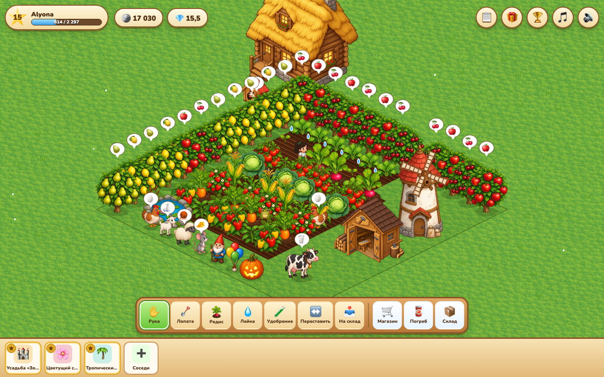

**[Quick start](#-quick-start)** · **[How to play](#-how-to-play)** · **[Multiplayer](#-how-multiplayer-works)** · **[Architecture](#-architecture)** · **[API](#-http-api)** · **[Tests](#-tests)** · **[Deployment](#-deployment)** · **[For AI assistants](#-for-ai-assistants-and-new-contributors)**

</div>

---

## 📜 History

> *"Dear farmers! We regret to inform you that the servers of Lovely Farm will be shut down on 7 October 2016. From that moment the project can be considered officially closed… We put an enormous amount of time, hope and work into this game, and we will all miss this wonderful world of farming and garden beds."*
> — the game team's farewell message

Lovely Farm (*Lyubimaya Ferma*) launched on Mail.ru's "My World" social network in the summer of 2010. In its first year it gathered **more than 5 million players** (about **800,000 a day**) and won **Best Social Game at KRI 2010**, Russia's game developers' conference. Six years later the servers were switched off.

This project brings it back. Using archived fan guides, player reviews and screenshots, it restores the economy (exact prices, growth times and XP for 37 crops, 24 trees and 20 animals), the mechanics and the spirit of the original. Everything known about the original, and everything that had to be invented, is in **[docs/RESEARCH.md](docs/RESEARCH.md)**.

---

## ✨ Features

| | |
|---|---|
| 🌱 **Garden** | Dig with a shovel (10 coins), plant, water, fertilize, harvest. Ripe crops wither after as long as they took to grow — just like the original. 37 crops, from radish to orange gerbera. |
| 🧑‍🌾 **The farmer** | Walks to every bed and "digs funnily". Clicks are queued, an hourglass marks pending cells. Customizable: farm boy or farm girl, hair, shirt and overalls colours. |
| 🥫 **Cellar** | Every crop, fruit and product goes "to the cellar", where you sell items one by one or all at once. |
| 🐦‍⬛ **Pests** | Crows and toads land on beds and stop growth. A scarecrow keeps crows away; a well-fed dog chases pests himself. You name the dog once (by default it is Buddy, Bello… depending on the language). |
| 🌳 **Orchard** & 🐄 **animals** | 24 trees and 20 animals with the original's numbers. Cows give milk, hens eggs, the greedy mouse cheese, and the lion… lion mane. |
| 🏭 **Production** | Workshop (greenhouse, scarecrow, birdhouse, bench), mill, juice press, kitchen (borscht, pancakes, syrniki, cherry pie). Queue of up to 3 jobs. |
| 🪴 **Greenhouse** | 12 beds on 6 tiles; no digging, watering or crows. Crafted from 20 wood and 10 plastic film — the original recipe. |
| 📋 **Orders** | Neighbours ask for produce; rewards are coins, XP and sometimes diamonds. |
| 🗺️ **Expansion** | 8×8 → 10×10 for 500 coins → 12×12 for 5 💎 or 10 neighbours → … → 18×18. |
| 👥 **Friends (real players)** | Search by login or name, friend requests, accepting. Visit a friend's farm to chase crows and water beds (5 times a day per friend) and send one gift a day. The owner receives help and gifts even while offline. |
| 🏡 **Village** | 80 computer neighbours with their own farms, so there is always someone to visit while real friends are few. |
| 🎁 **Gifts** | Daily gifts from neighbours and a "❤️ my wish" list. |
| 🏆 **Achievements** | 10 achievements with 3 tiers each, rewarded with diamonds like the original. |
| 🌍 **4 languages** | Russian, English, German, Azerbaijani: UI, all content names and server errors. |
| 📱 **Phones** | Touch, pinch-to-zoom, responsive layout. |

---

## 🖼️ Screenshots

| | |
|:-:|:-:|
| 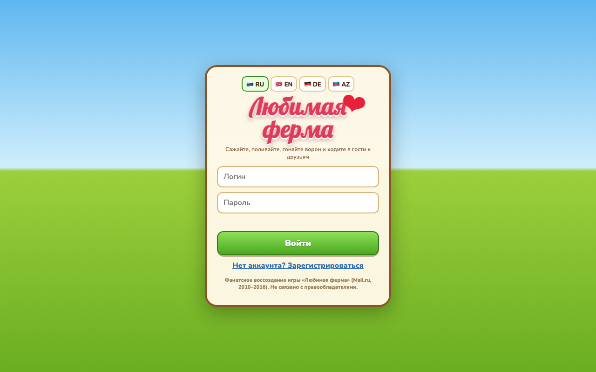<br>Sign-in in 4 languages | 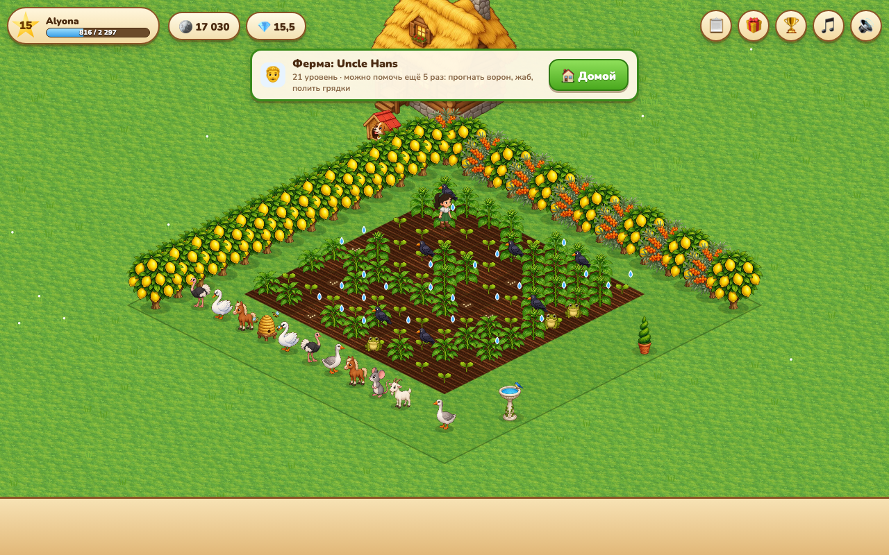<br>Visiting: crows, toads, dry beds |
| 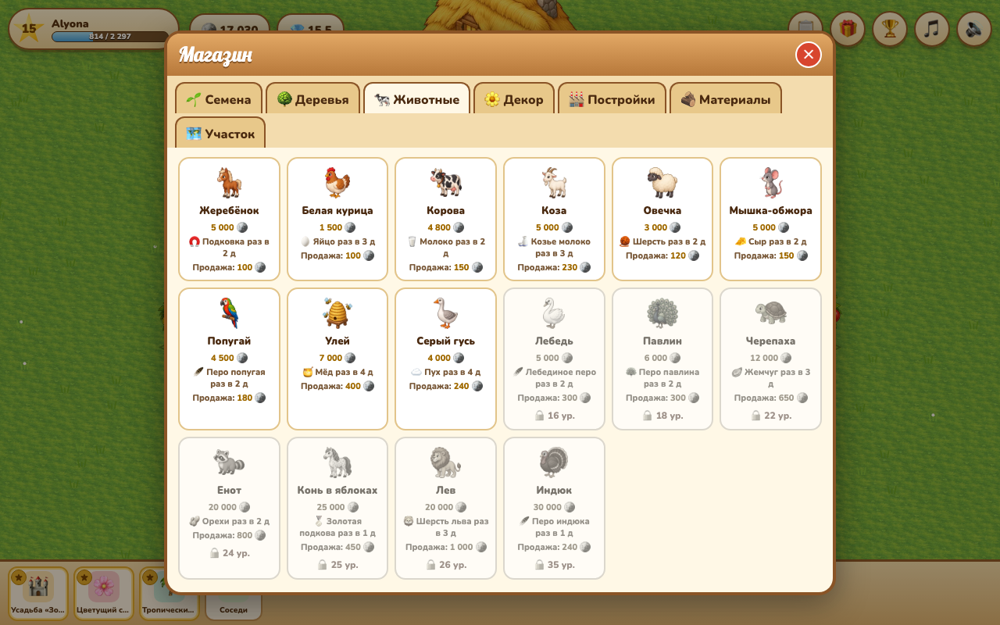<br>Shop | 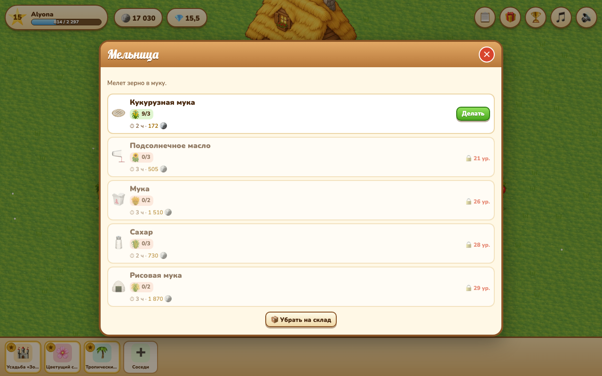<br>Mill and recipes |
| 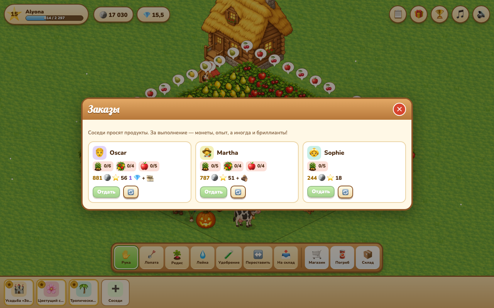<br>Neighbours' orders | 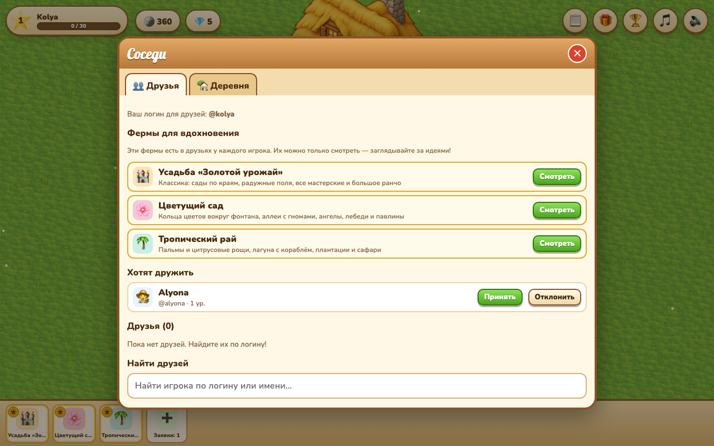<br>Friend requests |
| 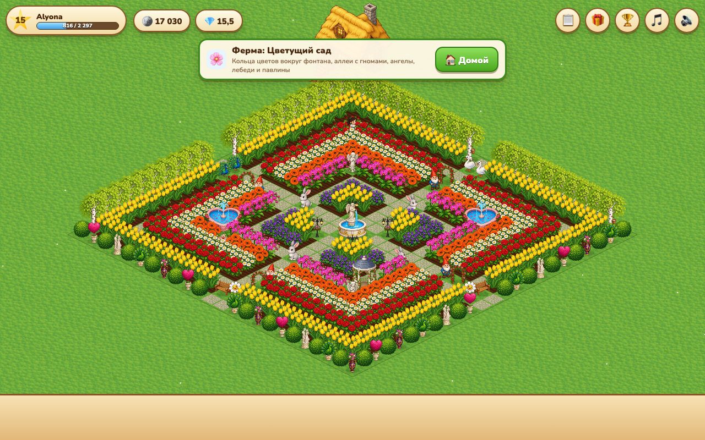<br>Showcase farm «Blossom Garden» | 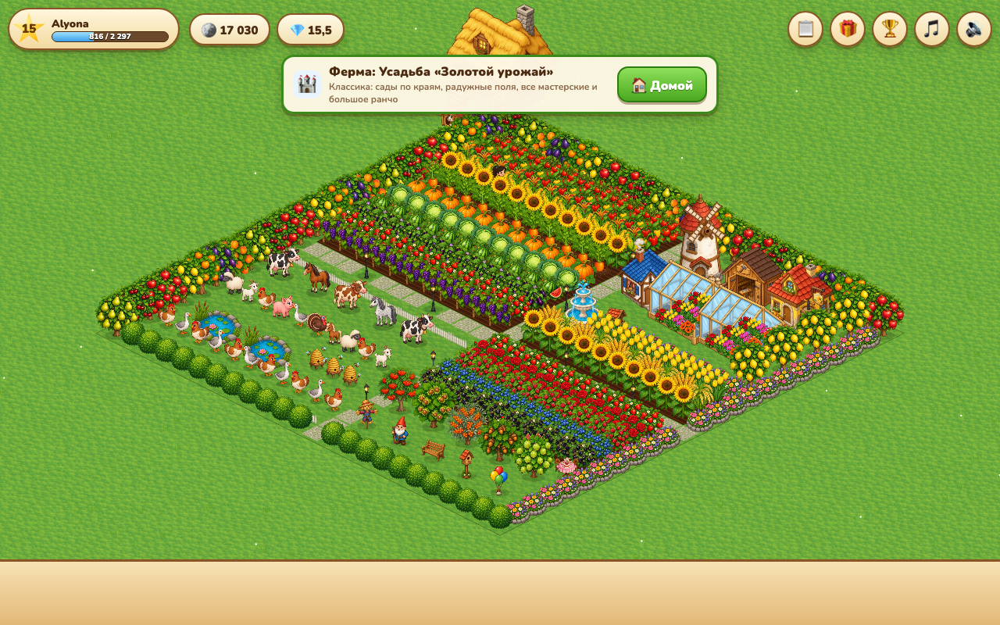<br>Showcase farm «Golden Harvest» |
| <br>English UI | 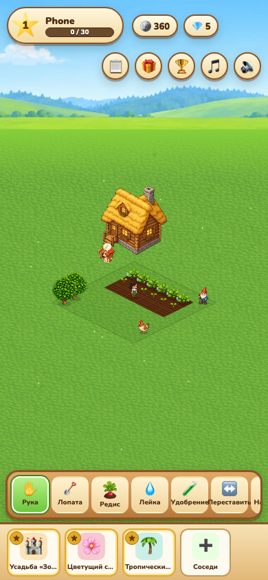<br>Phone |

Screenshots are generated automatically: `npm run screenshots`.

---

## 🚀 Quick start

Requires **Node.js 24+**. The server uses Node's built-in TypeScript support (type stripping) and `node:sqlite`, so it has **zero runtime dependencies**.

```bash
git clone https://github.com/Elkhan-Isayev/lovely-farm.fun.git lovely-farm
cd lovely-farm
npm install
npm run dev
```

Open **http://localhost:5173** and sign up. To try friendships and visits, register a second player in a private window or another browser.

| Command | What it does |
|---|---|
| `npm run dev` | API on `:3000` (restarts on changes) + Vite on `:5173` with hot reload; `/api` is proxied |
| `npm run build` | type-checks client and server, builds the client into `dist/` |
| `npm start` | production: one process serves the API and `dist/` on `PORT` |
| `npm test` | ~300 unit and integration tests |
| `npm run coverage` | the same with coverage (thresholds in `vite.config.ts`) |
| `npm run test:e2e` | end-to-end tests in Chromium (Playwright) |
| `npm run test:all` | types + coverage + e2e — **run before committing** |
| `npm run typecheck` | `tsc` for client, server and tests |
| `npm run screenshots` | regenerate the images in `docs/screenshots/` |

**Developer mode:** `http://localhost:5173/?dev`. The profile gains ×60 / ×600 time speed, and the running game is available in the console as `window.__farm` (`game`, `renderer`, `ctrl`, `hud`, `sync`, `ctx`).

```js
__farm.game.s.gold = 1e6; __farm.game.changed();   // get rich
__farm.game.setSpeed(600);                          // 1 game hour = 6 seconds
```

---

## 🎮 How to play

1. **🪏 Shovel** — dig grass (10 coins). Withered or harvested beds must be dug again.
2. **🌱 Seeds** — pick a crop and click beds. On untouched grass the farmer digs and plants in one go.
3. **💧 Watering can** — watering speeds growth by 10 %. Dry beds show a droplet.
4. **🧪 Fertilizer** — only after watering, another +15 %.
5. **✋ Hand** — harvest crops, fruit and products; chase a crow; open a building; pet the dog. Almost everything is done by hand.
6. **🥫 Cellar** — sell your harvest. **🛒 Shop** — trees, animals, 50 decorations (fences, lamps, fountains, statues, topiaries, a gazebo…), buildings, materials, land.
7. **↔️ Move** and **📥 To storage** — arrange your farm. Gifts and workshop products wait in **📦 Storage**.
8. **👥 Neighbours** (bottom strip) — three **showcase farms** every player has (a golden estate, a blossom garden, a tropical paradise — huge, fully decorated, look-only, for ideas), then friends and villagers. While visiting, click crows, toads and dry beds; helping earns coins and XP.

Keys: `1`–`7` select tools, `Esc` or right click cancels. Wheel or pinch zooms, dragging pans.

<details>
<summary><b>💰 Economy: a few rows from the original's table</b></summary>

Players measured efficiency as `(sale price − seeds − 10) / hours`.

| Crop | Level | Hours | Seeds | Sells for | XP |
|---|---:|---:|---:|---:|---:|
| Radish | 1 | 4 | 10 | 24 | 1 |
| Potato | 1 | 12 | 10 | 32 | 2 |
| Strawberry | 8 | 2 | 12 | 28 | 1 |
| Raspberry | 13 | 6 | 32 | 69 | 4 |
| Watermelon | 18 | 10 | 64 | 132 | 12 |
| Wheat | 26 | 96 | 250 | 500 | 5 |
| Rose | 31 | 8 | 76 | 156 | 20 |
| Orange gerbera | 35 | 4 | 300 | 348 | 10 |

The full data is in [`src/data/items.ts`](src/data/items.ts).
</details>

---

## 🌐 How multiplayer works

The farm is **simulated in the browser** (responsive, with offline progress), while **the server stores it and arbitrates every interaction between players**.

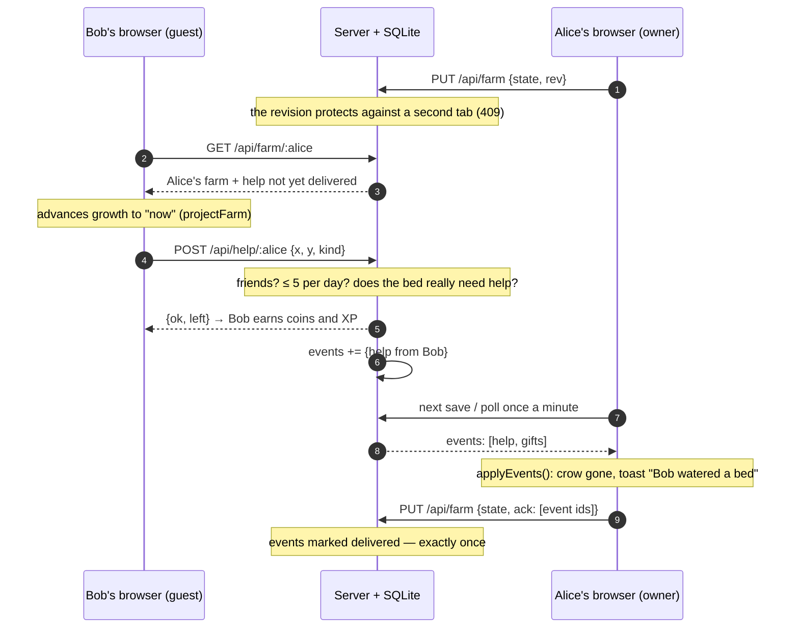

Key properties:

- **Exactly once.** An event is acknowledged only by a save that already includes it (`ack`), so help is never lost and never applied twice.
- **One tab.** Every save carries `rev`. A second tab gets `409` and the game offers a reload instead of overwriting progress.
- **The server arbitrates social actions:** friendship, daily help limits (5 per friend) and gift limits (1 per friend), a gift whitelist, and a check that the bed actually needs help.
- **Server-side days use Moscow time** (UTC+3) for the limits. The daily login bonus uses the player's local time.

---

## 🏗️ Architecture

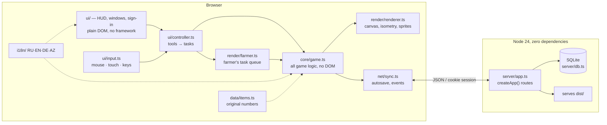

<details>
<summary><b>📁 Repository layout</b></summary>

```
lovely-farm/
├── index.html               the page: canvas#world + div#ui
├── src/
│   ├── main.ts              browser entry point
│   ├── app.ts               startup: sign-in → load farm → wire everything, game loop
│   ├── styles.css           2010-style wooden UI
│   ├── data/items.ts        content: crops, trees, animals, decor, buildings, recipes, achievements (no display names)
│   ├── core/                DOM-free logic (can move to the server)
│   │   ├── game.ts          Game class: resources, beds, objects, production, orders, neighbours, tick
│   │   ├── state.ts         GameState save shape, newState()
│   │   ├── levels.ts        XP curve
│   │   ├── neighbors.ts     80 villagers with deterministic farms
│   │   ├── showcase.ts      3 showcase farms every player can visit for inspiration
│   │   └── project.ts       advances growth on a friend's farm
│   ├── render/              canvas
│   │   ├── iso.ts           2:1 isometry (64×32 cell)
│   │   ├── art.ts           painted sprites (public/art/*.webp): loading, fitting
│   │   ├── artManifest.ts   generated list of painted sprites and their sizes
│   │   ├── sprites.ts       sprites from painted art, procedural fallbacks, sprite cache
│   │   ├── renderer.ts      frame: background, ground, depth sorting, object picking, floating labels
│   │   └── farmer.ts        the farmer: walking, tool animations, task queue
│   ├── ui/                  DOM UI: hud, panels (all windows), modal, auth, controller, input, icons, dom
│   ├── net/                 api.ts (fetch client), sync.ts (autosave and event inbox)
│   ├── audio/               music player (Suno tracks), synthesised farm ambience and sound effects
│   └── i18n/                index.ts, ru.ts (source), en/de/az.ts, ru-names.ts, people.ts — the only place with Russian text
├── server/
│   ├── app.ts               createApp({db, staticDir, now?, rateLimit?}) → {handle, cleanup, today}
│   ├── db.ts                SQLite schema and migrations
│   └── index.ts             entry point: PORT, DATA_DIR, STATIC_DIR, SECURE_COOKIE
├── tests/                   Vitest (happy-dom + fake canvas), tests/e2e — Playwright
├── public/                  art/ painted sprites (WebP, cut from art/sheets/), audio/ music
├── scripts/                 dev.mjs (API + Vite), screenshots.mjs, art/ (sheet cutting + prompts)
├── deploy/                  production: compose, Caddyfile, server setup, deploy and backup scripts
├── .github/workflows/       CI/CD
├── docs/                    RESEARCH.md (about the original), screenshots/
├── CLAUDE.md                instructions for Claude Code
└── Dockerfile
```
</details>

<details>
<summary><b>⏱️ Time, growth and saving</b></summary>

- Everything in the game runs on **game time**: `now = clock.game + (Date.now() − clock.real) × speed`. In production `speed = 1`; in `?dev` up to ×600.
- A bed stores **accumulated growth** `growth` (ms) rather than its planting time, so a pest can pause growth. On load the elapsed time is caught up in one tick, but **pests never appear retroactively**.
- Trees, animals and building jobs store absolute `readyAt` / `endsAt`.
- The farm is saved every 15 seconds when something changed, and when the page is hidden. Events are polled once a minute.
</details>

<details>
<summary><b>🎨 Graphics</b></summary>

No assets from the original are used. Every crop (ripe and young), tree (with and without fruit), animal, decoration and building, the house, the sky backdrop and the ground textures are **painted pictures generated with Higgsfield** (GPT Image 2.5) in one cozy hand-painted style, cut from sprite sheets by `scripts/art/slice.py` into `public/art/*.webp` (~4 MB, preloaded during sign-in). How to generate more in the same style: [scripts/art/prompts.md](scripts/art/prompts.md). While a picture loads — and in unit tests — the game falls back to sprites **drawn in code** in `render/sprites.ts` and emoji. The farmer is a painted 16-frame animation (walk cycle, digging, watering, sowing, harvesting…) for a boy and a girl, recoloured to the player's chosen hair and clothes colours through masks. Objects are depth-sorted by `x + y` of their front corner. Clicks on tall objects (trees, buildings) are matched against rectangles recorded during the last frame.
</details>

---

## 🔌 HTTP API

All responses are JSON. Errors come as `{ "error": "<code>" }`; the client translates the code via `err.<code>` in i18n. The session is an httpOnly `sid` cookie valid for 60 days.

| Method | Path | Body / params | Response |
|---|---|---|---|
| `POST` | `/api/register` | `{login, password, name?, face?}` | `{ok}` + cookie |
| `POST` | `/api/login` | `{login, password}` | `{ok}` + cookie |
| `POST` | `/api/logout` | — | `{ok}` |
| `GET` | `/api/me` | — | `{user, farm: {state, rev} \| null, events}` |
| `PUT` | `/api/farm` | `{state, rev, ack?, level?, face?}` | `{rev, events}` · `409 conflict` |
| `GET` | `/api/events` | — | `{events}` |
| `GET` | `/api/friends` | — | `{friends: [{…, helpLeft, giftSent}], incoming, outgoing}` |
| `GET` | `/api/users/search?q=` | ≥ 2 characters | `{users: [{…, status}]}` |
| `POST` | `/api/friends/request` | `{id}` (a counter-request accepts) | `{ok, status}` |
| `POST` | `/api/friends/accept` | `{id}` | `{ok}` |
| `POST` | `/api/friends/remove` | `{id}` (decline / cancel / unfriend) | `{ok}` |
| `GET` | `/api/farm/:id` | friends only | `{owner: {…, helpLeft}, farm}` |
| `POST` | `/api/help/:id` | `{x, y, kind: "chase" \| "water"}` | `{ok, left, error?}` |
| `POST` | `/api/gift/:id` | whitelisted `{key}` | `{ok, error?}` |

Logins: 3–24 characters (Latin or Cyrillic letters, digits, `_ . -`), compared case-insensitively. Sign-in and sign-up are rate-limited per IP (`X-Forwarded-For`).

<details>
<summary><b>🎵 Sound</b></summary>

**Music**: four instrumental country tracks generated with [Suno](https://suno.com) (*Two-Step Fun*, *Farm Walk*, *Pastoral Peace*, *Hoedown on the Farm*), streamed from `public/audio/` in a shuffled loop (list in `src/audio/music.ts`; the server supports HTTP ranges for streaming). **Ambience and effects** are synthesised in the browser with Web Audio: a farm ambience (breeze, birds, distant cows and hens) and an effect for every action (digging, sowing, watering, harvesting, hammering, shooing crows, coins, level-up) plus a voice for every animal. Two switches in the top bar (🎵 music, 🔊 sounds); audio starts on the first click, as browsers require.
</details>

<details>
<summary><b>🗄️ Database schema</b></summary>

| Table | Purpose |
|---|---|
| `users` | `id, login, login_key (normalized, unique), name, pass (scrypt), level, face, search` |
| `sessions` | `token → user_id, expires` |
| `farms` | `user_id → state (JSON), rev, updated` |
| `friends` | `a → b, status: pending \| accepted` (a sent the request) |
| `events` | inbox: `user_id, from_id, type: help \| gift, payload, delivered` |
| `help_log` / `gift_log` | daily help and gift limits |

Migrations are idempotent and run at startup (`server/db.ts`). Expired sessions, old logs and delivered events are purged hourly.
</details>

---

## 🧪 Tests

**Project rule: everything is tested, from the UI down to the database.** Coverage thresholds are enforced in `vite.config.ts` (90 % lines and functions, 80 % branches); currently ≈ **99.5 % lines / 97 % branches**.

| Layer | How it is tested |
|---|---|
| Game logic, data, levels, saves | pure unit tests with mocked time (`vi.setSystemTime`) |
| Localization | every key and every content name in all 4 languages, matching placeholders |
| Graphics | every sprite at every stage through a fake 2D context (painted and procedural), the art manifest against the files and the content, the loader, renderer, farmer, hit testing |
| UI | every window and button in happy-dom with a real game and a fake API |
| Input | pointer, pinch, wheel, keys |
| Server | **real HTTP and a real SQLite database** in a temp folder: all routes, limits, sessions, migrations, static files, 413/429/500 |
| End to end | Playwright: two browsers sign up, become friends, one helps the other and sends a gift; language switching; phone layout |

The tests have already caught 6 real bugs: Cyrillic login case sensitivity, a hanging connection after a 413, double charging on a double click, the watering can versus a toad, `readyAt = 0`, and the friend search being wiped by a list refresh.

Russian text in tests appears only where a test checks the Russian locale's output or feeds Cyrillic input on purpose (login normalization, search, transliteration).

---

## 🚢 Deployment

Production: **https://lovely-farm.fun** — Cloudflare in front, a DigitalOcean droplet (Ubuntu 24.04) behind it, the game in Docker behind [Caddy](https://caddyserver.com). Everything is in [`deploy/`](deploy/README.md); **CI/CD** is [`.github/workflows/ci.yml`](.github/workflows/ci.yml):

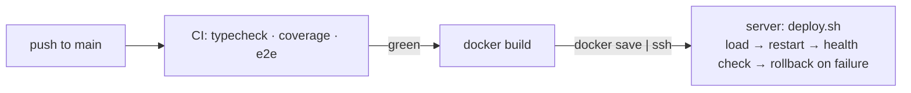

- **Security**: Cloudflare in front (DDoS protection, "Full (strict)" TLS to an origin certificate) and the web ports open to Cloudflare only; no root login, SSH keys only (no passwords), fail2ban, automatic security updates; the CI key can only run `deploy.sh`; the game container is unprivileged, read-only, without capabilities, reachable only through Caddy; strict CSP and security headers.
- **Backups**: a consistent SQLite copy every night (`deploy/backup.sh`), 14 days kept.

Running it yourself:

```bash
docker build -t lovely-farm .
docker run -d --name farm -p 3000:3000 -v farm-data:/data lovely-farm
```

| Variable | Default | Description |
|---|---|---|
| `PORT` | `3000` | port |
| `DATA_DIR` | `./data` (`/data` in Docker) | where `farm.sqlite` lives — **back this file up** |
| `STATIC_DIR` | `./dist` | the built client |
| `SECURE_COOKIE` | — | `1` when served over HTTPS |
| `TRUST_PROXY` | — | `1` behind your own reverse proxy: the client IP is the last `X-Forwarded-For` entry (otherwise the header is ignored, so it cannot be forged to get around the sign-in rate limit) |

---

## ⚠️ Known limitations

- **The client is trusted with its own farm's economy**: coins on your own farm can be tweaked from the console. Social actions are verified by the server. Fair leaderboards would require moving `core/` to the server — it is DOM-free for exactly that reason.
- A single SQLite file and one process: enough for thousands of players. Horizontal scaling would need another database.
- No password recovery (no email), no name moderation.

Contributions on any of these are welcome.

---

## 🤖 For AI assistants and new contributors

- **[CLAUDE.md](CLAUDE.md)** — short rules for working in this repository (read automatically by Claude Code).
- **[docs/RESEARCH.md](docs/RESEARCH.md)** — what is known about the original game and where the numbers come from.
- **[scripts/art/prompts.md](scripts/art/prompts.md)** — how the painted art was generated and how to add more in the same style.
- **Everything in the repository is English.** Russian text lives only in `src/i18n/` (a test enforces it).

---

## ⚖️ Legal

A non-commercial fan project. *Lyubimaya Ferma* is a trademark of its rights holders; this project is not affiliated with them. All graphics are new (generated for this project with Higgsfield, or drawn in code); no assets of the original are used. Research on the original is based on public player reviews and guides; sources are listed in [docs/RESEARCH.md](docs/RESEARCH.md).

**Credits.** Music made with [Suno](https://suno.com) (free plan: non-commercial use with attribution). Art generated with [Higgsfield](https://higgsfield.ai). Fonts: Lobster and Nunito (Google Fonts, SIL Open Font License).

**Contact**: questions and suggestions — [github.com/Elkhan-Isayev](https://github.com/Elkhan-Isayev).

<div align="center"><sub>Happy harvesting! 🥕</sub></div>
